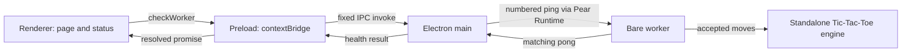

# Desktop architecture

[Project setup](../README.md) · [Verification](verification.md) ·
[Game-engine API](../games/README.md)

## Current communication path

All arrows are communication **on one computer**. The Bare worker uses the independent game engine for room matches.
This diagram covers local IPC only. Opt-in remote connections are described in
[peer discovery](peer-discovery.md).

## Layers and files

| Location | Responsibility |
| --- | --- |
| `renderer/index.html`, `style.css` | Heading, status text, check button, and minimal styling |
| `renderer/app.js` | Requests health checks and updates the page |
| `electron/preload.js` | Exposes fixed health, room and game operations through `contextBridge` |
| `electron/main.js` | Creates the window, starts Bare, validates IPC callers, and handles shutdown |
| `electron/worker-client.js` | Matches ping/pong IDs and handles timeouts and disconnections |
| `p2p/main.mjs` | Bare entry point; answers local pings and starts discovery when configured |
| `p2p/discovery.mjs` | Hyperswarm lifecycle, connection counts, errors, and cleanup |
| `games/tictactoe.js` | Independent rules, move validation, turn order, wins, and draws |
| `test/` | Node tests for the game rules and local communication components |
| `package.json`, `package-lock.json` | Scripts, runtime requirements, and dependency versions |
| `.nvmrc`, `.gitignore` | Recommended Node version and exclusions for local/generated files |

### Runtime responsibilities

- **Electron** supplies the desktop shell and browser-style renderer. Its main
  process owns privileged application lifecycle operations.
- **Pear Runtime** is the library main uses to launch a Bare process with
  `PearRuntime.run()`. It returns a duplex stream for communication.
- **Bare** executes the worker separately from Electron. `Bare.IPC` is the other
  end of the local stream. The runtime is supplied by the transitive
  `bare-sidecar` dependency, not a separately installed global tool.
- **Hyperswarm** discovers peers and supplies encrypted connections when
  `PEERARCADE_TOPIC` is configured. Without a topic, no developer swarm is constructed; normal room actions start their own swarm.

The game engine uses CommonJS and has no Electron, Bare, or networking imports.
Its public API remains documented in [games/README.md](../games/README.md).

## Rooms

The same four-layer path now supports fixed room operations. Main creates and
validates invitations, while Bare owns discovery, role handshakes, admission, and
cleanup. The renderer only displays status and invokes allowed operations. See
[rooms](rooms.md) for the protocol, files, bearer-secret boundary, and live tests.
Room mode and environment-configured developer discovery are mutually exclusive.

## Desktop game interface

`renderer/game.js` renders accepted snapshots, enforces disabled cell states,
and guards pending moves and stale responses. `renderer/rooms.js` coordinates
room controls and the non-overlapping 500ms refresh. No game rules run in the UI.
See [manual verification](game-interface.md).

## Game synchronization

`p2p/game-sync.mjs` handles host authority, request IDs and revisions. `p2p/rooms.mjs`
creates one match after admission and destroys it on departure. Main and preload
expose only validated `requestMove` and `gameState` operations. See the
[protocol guide](game-sync.md) for messages, runtime compatibility and limits.

## A health check, step by step

1. The renderer calls the no-argument `checkWorker()` method. It disables the
   button while checking and shows a checking message.
2. Preload invokes the fixed `peerarcade:check-worker` channel. It does not expose
   generic send/invoke functions, Node APIs, or Electron event objects.
3. Main accepts only its own window's main frame at the expected local page URL,
   with no arguments. Unauthorized calls are rejected.
4. The worker client writes `ping:<id>` followed by a newline. Bare recognizes
   that format and replies with `pong:<id>` followed by a newline.
5. The client matches the reply to the pending check. Main returns
   `{ status: 'ready', reply: 'pong' }`, or
   `{ status: 'unavailable', reply: null }` on a worker-check failure.
6. The promise resolves through preload to the renderer, which updates the text
   and enables the button. Bridge errors also produce an unavailable message.

Stream chunks can split or combine messages, so both ends wait for complete
lines. Concurrent calls share one pending check. IDs prevent a late reply from
satisfying a later check; the timeout is three seconds. An end, close, or error
rejects pending and future checks. There is no automatic worker restart.

The renderer checks on startup, on click, and every five seconds. Closing the
window asks Bare to destroy its swarm before main closes the worker client and
quits. Shutdown is bounded by timeouts to avoid hanging on network cleanup.

## Local IPC versus future P2P

IPC means inter-process communication. Here it connects processes belonging to
one application on one machine. It requires no room, remote identity, or peer.
A successful pong confirms local worker responsiveness only.

Hyperswarm discovery and minimal rooms are implemented in Issues #6–#7. Future
The [multiplayer interface](game-interface.md) now uses fixed preload calls; [state synchronization](game-sync.md) is implemented. Those capabilities are listed separately in
the [roadmap](../README.md#next-milestone-v02--p2p-multiplayer). They are not
implemented by installing Hyperswarm or by placing a worker under `p2p/`.

## Decisions and tradeoffs

| Decision | Benefit and tradeoff |
| --- | --- |
| Separate renderer, preload, main, and worker | Keeps privileged APIs out of the page and future networking isolated; adds explicit message boundaries |
| Fixed health and room APIs | Explicit operations and argument validation; no arbitrary IPC channels exposed |
| Sandbox and context isolation enabled; Node integration disabled | Limits renderer privileges; the renderer must use the preload bridge |
| Local-only script/style CSP; navigation and new windows blocked | Suits the current local window; future external content needs explicit design |
| Numbered, newline-delimited ping/pong | No messaging dependency; intentionally limited to health checks rather than general game messages |
| Poll every five seconds; timeout after three | Simple health reporting, but failure display is not instantaneous; failed workers require an app restart |
| Plain HTML/CSS/JavaScript and Node's test runner | Few dependencies and no bundler; no hot reload or packaged distribution workflow |
| Independent, immutable Tic-Tac-Toe snapshots | Rules can be tested without the desktop; UI renders accepted snapshots; Bare imports the same rules engine |

Pear Runtime brings storage-related transitive packages, but this application
does not instantiate its storage/updater APIs. Application persistence and
authentication are absent. Electron itself may create normal runtime cache files;
that is not a saved-game feature.

The design follows the
[official Holepunch Electron/Bare tutorial](https://docs.pears.com/p2p/getting-started/build-a-peer-to-peer-chat/build-a-peer-to-peer-chat/),
without its chat or styling framework; discovery is opt-in as documented separately. The lockfile currently resolves
Electron 44.7.0, Pear Runtime 1.3.1, and Hyperswarm 4.17.2. Electron was updated
from the tutorial's version during Issue #2 after npm audit findings; see the
[official 44.7.0 release](https://github.com/electron/electron/releases/tag/v44.7.0).
